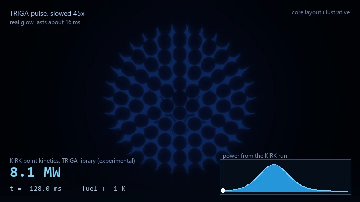
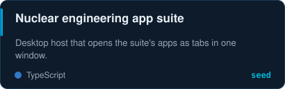
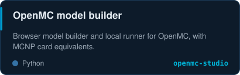
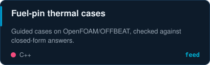
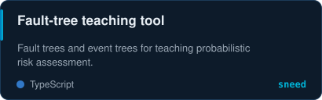
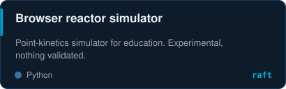
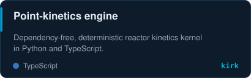
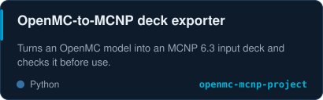
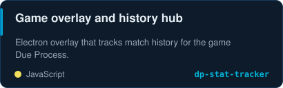

Cherenkov glow of a TRIGA-style core during a pulse (slowed 45×). Brightness and readouts come from a run of my own point-kinetics engine, <a href="https://github.com/bluetyde/kirk">KIRK</a>.

     

## ⚛️ What I build

Open-source tools for reactor physics, thermal analysis, and engineering education. Everything below is public and MIT licensed.

<table>
<tr>
<td></td>
<td></td>
</tr>
<tr>
<td></td>
<td></td>
</tr>
<tr>
<td></td>
<td></td>
</tr>
<tr>
<td></td>
<td></td>
</tr>
</table>

